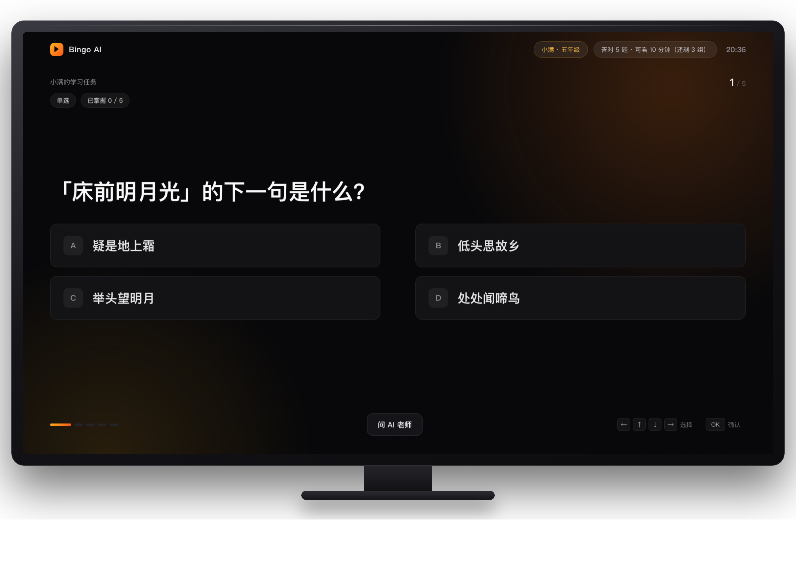
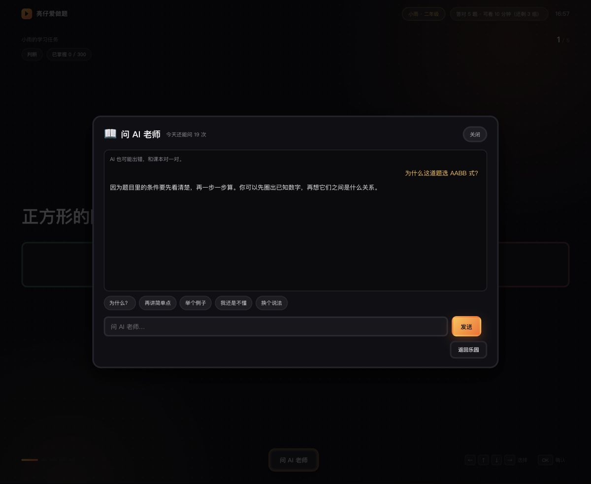
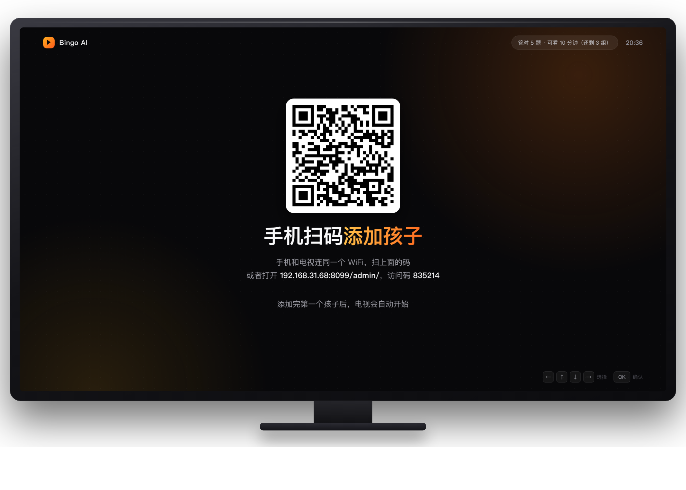
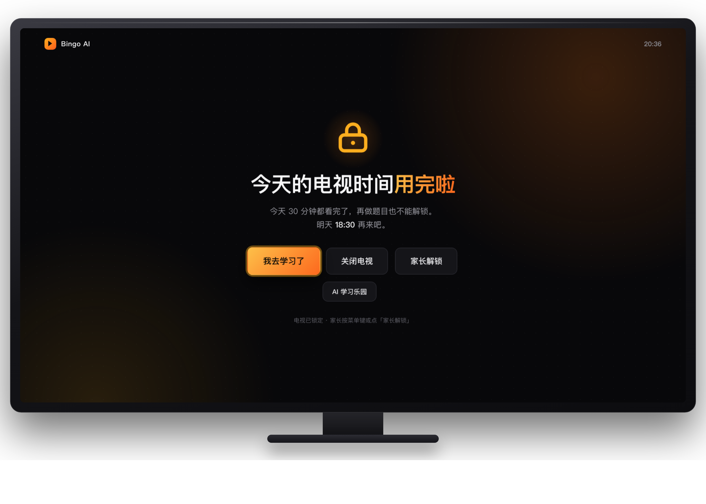
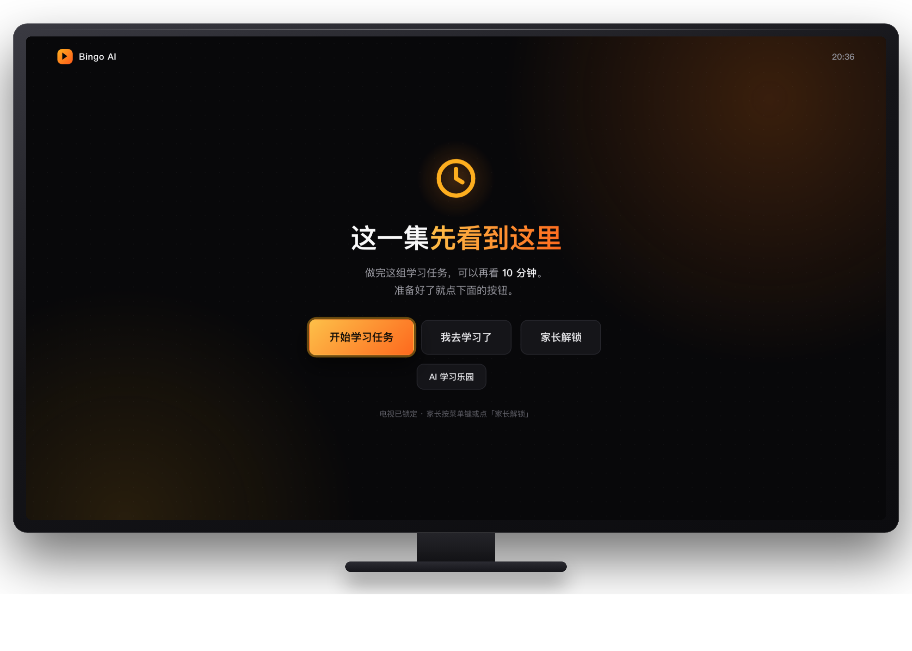
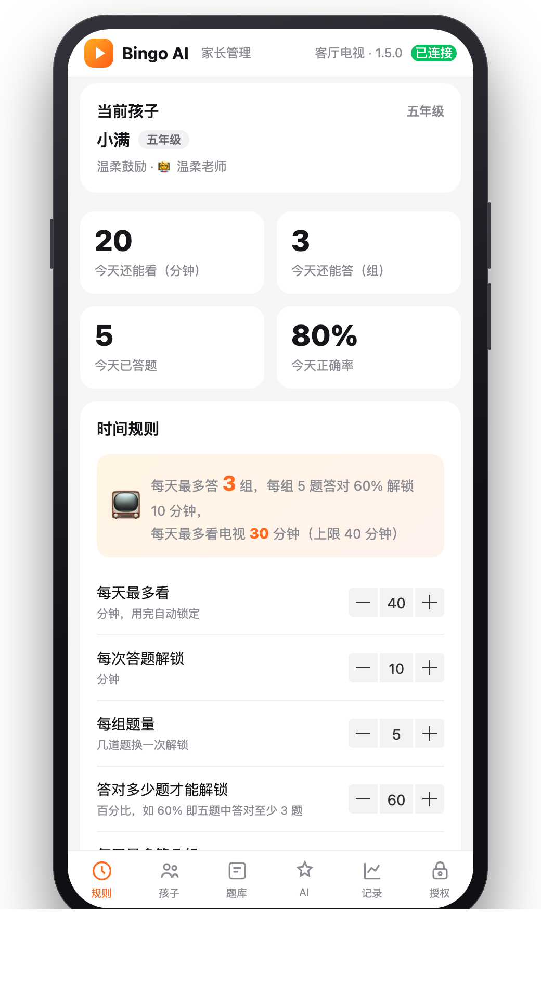
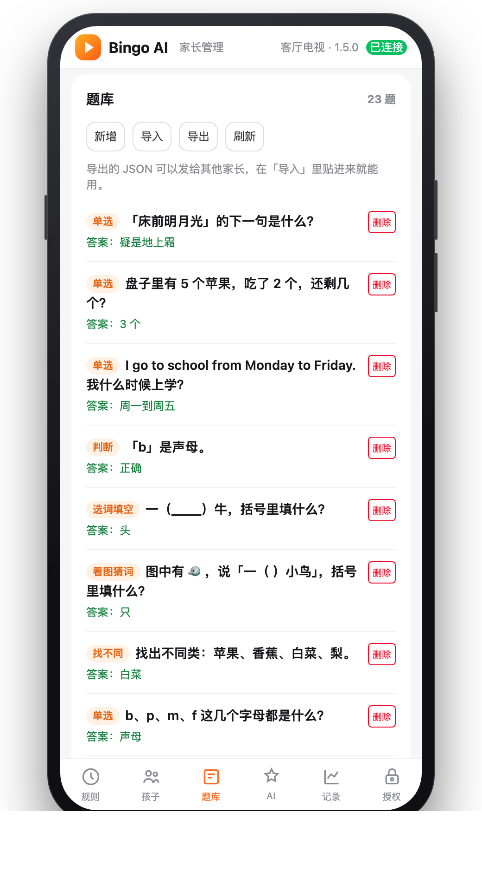
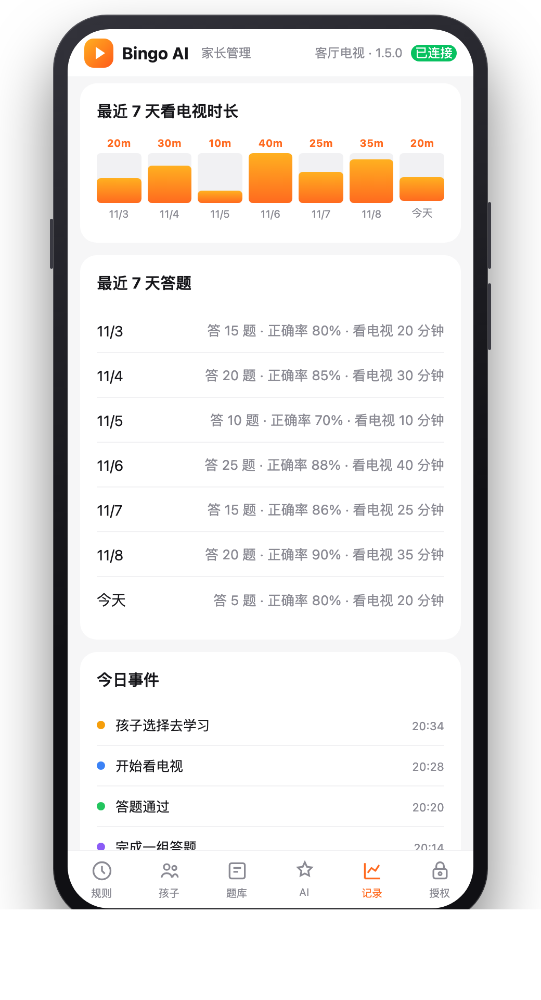

<div align="center">

# Bingo AI TV版

### 先学再看 · 让电视时间更有价值

**Learn first. Watch later.** · 开源 Android TV 应用，不需要服务器、不需要账号

由 **缤纷科技** 出品。

本项目已链接并认可 [LINUX DO](https://linux.do) 社区。

[](https://github.com/bingo-2026/bingoTV/stargazers)
[](https://github.com/bingo-2026/bingoTV/releases/latest)
[](https://github.com/bingo-2026/bingoTV)
[](./LICENSE)

</div>

---

## 先装到电视上

不需要 Root，U 盘或 ADB 装均可。各品牌开 ADB 的位置、装完要开的权限，都在这里：

👉 **[安装指南 → docs/install.md](./docs/install.md)**

已经构建好的安装包在仓库里：

| | 电视版 | 平板版 |
|---|---|---|
| 安装包 | `dist/BingoAI-tv-v1.5.0.apk`（约 1.1 MB） | `dist/BingoAI-pad-v1.5.0.apk`（约 1.1 MB） |
| 包名 | `com.bingotech.tv` | `com.bingotech.pad` |
| 应用名 | Bingo AI | Bingo AI 平板 |
| 版本 | 1.5.0（versionCode 13） | 1.5.0（versionCode 13） |
| 签名 | 自签名证书 `app/native/studyontv-release.jks`（口令在 `app/native/local.properties`，不入库） | 同一证书 |

> 1.3.0 起电视版包名改为 `com.bingotech.tv`，和旧版 `com.studyontv.tv` 是两个独立应用。新版需要全新安装和重新建孩子档案；旧版可以继续保留，也可以卸载。
>
> 1.4.0 起新增**独立的平板版**安装包 `dist/BingoAI-pad-v1.4.0.apk`（包名 `com.bingotech.pad`，应用名「Bingo AI 平板」），和电视版是两个独立应用，介绍见下文「Android 平板版」一节。
>
> 小米电视等禁止第三方桌面的机型，不需要设默认桌面：开启**无障碍服务**后，Home 键会被拦截并跳回答题页（步骤见 [小米电视 / MiTV](#小米电视--mitvandroid-6)）。其他机型可以再设默认桌面作为双保险。

---

## Android 平板版

1.4.0 起提供**独立的平板安装包** `dist/BingoAI-pad-v1.4.0.apk`（包名 `com.bingotech.pad`，应用名「Bingo AI 平板」）。它是完全独立的**一个 APK**：自带 HTTP 服务和 SQLite，**不需要电视、不需要同一个 WiFi、不需要手机扫码配对**。每台平板各有自己的孩子档案、2000 题题库、时间规则和 AI Key，和电视互不同步。

安装方式和电视一样（ADB 或 U 盘，见 [安装指南](./docs/install.md)），但**不要**给它设默认桌面——平板版包里没有任何 HOME 入口，不会变成主屏幕。

### 装完要开的四项权限

| 权限 | 位置 | 不开的后果 |
|---|---|---|
| 无障碍服务 | 设置 → 无障碍 → 已下载的服务 → Bingo AI 平板守护 | 检测不到前台应用、拦不住 Home 键，锁屏时拉不回答题页 |
| 使用情况访问 | 设置 → 应用 → 特殊权限 → 使用情况访问 | 无障碍被系统清理后没有兜底 |
| 显示在其他应用上层 | 设置 → 应用 → 特殊权限 | 时间到时盖不住画面 |
| 关闭电池优化 | 首次引导第 5 步直达（设置 → 电池 → 电池优化） | 系统可能清理守护服务，到点不自动锁回 |

首次打开先进入五步权限引导，逐项开通上面四项权限（**第 5 步是「关闭电池优化」**，没有「设为默认桌面」这一步）。点「完成，开始使用」后，家长输入 6 位 PIN（默认 `135790`）并建第一个孩子，再进入答题页。

### 家长入口

顶部栏右上角 **「家长」→ 输入 6 位 PIN（默认 `135790`）→ 家长菜单 →「家长设置」**，打开应用内嵌的管理页（限宽 720px），可以改孩子、规则、题库、AI 和使用记录。平板家长菜单里**没有**「手机扫码绑定」，那是电视版的入口。

### 已知限制

和电视版一样，这是**尽力拦截**，不是不可绕过的系统锁：拔电源、进系统设置强行停用无障碍、HDMI 外接设备都不在拦截范围内。

---

## 试用与授权

首次创建孩子档案起 **7 天试用**，全部功能可用。到期当天仍可正常使用，**次日 00:00 起**电视/平板进入激活页：

- 激活页显示本机 16 位设备码和手机管理页二维码；
- 手机扫码 → 底部「授权」→ 粘贴激活码 → 点「激活」，电视/平板自动解锁；
- 到期后管理页和本地 HTTP 服务**仍然可用**（否则没法激活），AI 对话暂停返回 `402`，无障碍守护照常拦截。

**家庭版**一次买断，随喜打赏 **10–100 元**（仅支持微信个人支付），**一份激活码最多绑定 2 台设备**（电视 + 平板各一台），含未来版本免费升级。

购买请把设备码和付款截图发到 **bingo2026@yeah.net**，人工回复激活码。设备码在「家长设置」→「授权」里，电视和平板各有自己的设备码。

> 这是**离线授权**，不联网校验、不能远程撤销：换机或恢复出厂后设备码会变，把新设备码发回邮箱重新出码即可；卸载重装会清掉本机孩子档案和计时。运营细节见 [docs/licensing.md](./docs/licensing.md)。

---

## 它能做什么

孩子想看电视，先做几道题；答对解锁对应时长，时间到自动锁屏。题目、规则、记录全部存在电视本地。AI 学习伙伴是**可选**的在线能力，不配置也完全不影响离线答题、计时和门禁。

| 电视端 | 手机端 |
|---|---|
| 遥控器答题 → 解锁时间 → 到点锁屏 | 扫电视上的二维码，管理孩子、改规则、加题库、查记录、配置 AI |

手机管理页由电视自己托管，扫码直连，不依赖任何外网。

### 多个孩子，各自进度

- 一台电视可以建多个孩子档案，每个孩子有独立昵称、年级、鼓励语风格和 AI 学习伙伴；
- 题库按年级自动切换：一年级到六年级，共 **2000 题**；
- 每个孩子的答题进度、看电视剩余时间和每天组数**分开计算**；
- 家长在手机管理页添加、编辑、删除孩子；电视家长菜单只负责切换当前孩子，切换后标题和题库立即跟着变；
- 1.3.0 换用新包名，首次打开时家长输入 PIN 后填写第一个孩子的昵称和年级，之后可以继续添加其他孩子；
- 旧版 `com.studyontv.tv` 的数据不会自动迁移；需要保留家长自建题目时，先在旧版管理页导出 JSON，再到新版导入。

### AI 学习伙伴（可选）

在手机管理页填入任意 **OpenAI 兼容接口**的 Base URL、模型名和 API Key，就可以在电视上：

- 问 AI：讲题、解释错题，回答以**流式卡片**逐字显示，首字更快；
- 题目页点「问 AI 老师」会**自动带入题干、选项、科目和年级**，不用手抄；答题前不会把正确答案和讲解发给 AI；
- 答错后点「让 AI 讲讲」会补充错选、正确答案和讲解，并切换成「为什么是这个答案？」「我是怎么错的？」等一键追问；
- 玩一玩：猜谜语、脑筋急转弯、成语接龙；
- 听故事：太空、动物王国、数学王国、成语世界；
- 四种伙伴角色：温柔老师、好奇科学家、故事大王、活力队长；
- 系统 TTS 朗读回答（电视没有中文引擎时自动隐藏朗读按钮）。

AI 默认每个孩子每天 20 次，不消耗电视时间，全天可用；家长可以随时关闭、改次数、查看或清空最近问答。Key 只存在电视本机，不会出现在网页、接口或日志里。详见 [AI 配置指南](./docs/ai-setup.md)。


### 先答题，再看电视

从 1.0.1 开始，应用可以设为电视的**默认桌面**；小米电视等禁止第三方桌面的机型则用**无障碍服务**拦截 Home 键。设好之后：

- **开机 / 待机唤醒**：自动回到答题页，答完一组才解锁电视时间。
- **按 Home 键**：回到答题页，不能靠 Home 键绕过。
- **答完一组**：停在结算页，由孩子自己点「去看电视」或「再做一组」，不会突然跳走。
- **时间到**：守护服务把画面拉回答题页；每天 3 组答完、时间也用完后显示「今天的电视时间用完啦」。
- **家长解锁**：按遥控器菜单键，输入 6 位家长密码（默认 `135790`），可以临时解锁 10 / 30 分钟、今天不再锁、再加一组题，或直接打开系统设置。

> 说明：这是「尽力拦截」，不是不可绕过的系统锁。孩子如果拔电源、进系统设置强行改默认桌面，仍然可以绕开；HDMI 外接设备也不在拦截范围内（应用只能周期性尝试拉回）。需要更强约束时，请配合电视自带的儿童模式使用。

### 第一次打开：先建孩子档案

- 全新安装 1.3.0 后，电视会自动进入首次设置页；
- 家长输入 6 位 PIN（默认 `135790`），填写第一个孩子的昵称、年级、鼓励语风格和 AI 伙伴；
- 新包名从空数据开始，不会读取旧版记录；
- 之后在手机管理页「孩子」标签里可以继续添加弟弟妹妹，并分别设置年级和风格。


---

## 设为默认桌面（推荐）

装好并开完权限后，在电视上操作：

**设置 → 应用 → 默认应用 → 主屏幕 / 桌面 → 选择「Bingo AI」**

也可以从应用内的「家长引导」第 5 步直接跳转到默认桌面设置页。

用 ADB 设置和恢复（把 `<电视IP>` 换成实际地址）：

```bash
adb connect <电视IP>:5555

# 设为默认桌面
adb shell cmd role add-role-holder android.app.role.HOME com.bingotech.tv

# 确认当前默认桌面
adb shell cmd package resolve-activity --brief -a android.intent.action.MAIN -c android.intent.category.HOME

# 恢复原来的电视桌面（小米为例，先撤销本应用的 HOME 角色）
adb shell cmd role remove-role-holder android.app.role.HOME com.bingotech.tv
```

如果 `cmd role` 不可用，改用：

```bash
adb shell cmd package set-home-activity com.bingotech.tv/.MainActivity
# 老系统
adb shell pm set-home-activity com.bingotech.tv/.MainActivity
```

恢复原桌面也可以直接在电视的「默认应用 → 主屏幕」里重新选回小米桌面 / 当贝桌面等。

---

## 截图

<div align="center">


<br><sub>遥控器选题，第一次答错有提示，第二次答错公布答案和讲解</sub>

<br><br>


<br><sub>问 AI 老师：讲题、快捷追问、朗读，次数按孩子独立计算</sub>

<br><br>


<br><sub>家长扫码，手机和电视同一个 WiFi 即可</sub>

<br><br>


&nbsp;&nbsp;

<br><sub>每日时间用完 · 单次时间到了需要再答题</sub>

<br><br>

<table><tr>
<td align="center"><br><sub>规则设置</sub></td>
<td align="center"><br><sub>题库管理</sub></td>
<td align="center"><br><sub>7天使用记录</sub></td>
</tr></table>

</div>

---

## 家长能设置什么

| 设置项 | 说明 |
|---|---|
| 孩子档案 | 添加/编辑/删除孩子，设置昵称、年级、鼓励语风格和 AI 伙伴；每个孩子进度和时间独立 |
| 每天最多看 | 超出后当天锁死，第二天重置 |
| 每次答题解锁 | 一组题答完解锁几分钟 |
| 每组题量 | 一组几道题 |
| 答对比例 | 答对多少题才算通过（百分比） |
| 每天最多答几组 | 答完上限即锁定 |
| 可用时段 | 不在时段内只显示学习页 |
| 答题音效 | 答对、连击和通过时的合成提示音，可一键静音 |
| 家长解锁密码 | 6 位数字，电视上按菜单键输入；保存后立即生效 |
| AI 学习伙伴 | 总开关、OpenAI 兼容地址、模型、Key、每日次数、回答长度、朗读；可选 |
| 鼓励语风格 | 温柔鼓励 / 幽默搞笑 / 学霸热血 / 简洁有力，每个孩子单独设置 |

电视装好后，按遥控器 **菜单键 → 输入家长密码（默认 `135790`）→「手机扫码绑定」**，电视会显示二维码、局域网地址和 6 位访问码。手机连同一个 WiFi 扫码即可打开管理页；扫码不方便也可在手机浏览器手动输入电视地址再填访问码。扫码入口从 v1.0.5 起常驻家长菜单。

平板版没有扫码这一步：顶部栏右上角 **「家长」→ 输入 PIN →「家长设置」**，直接打开应用内的管理页，改的也是同一套孩子、规则、题库、AI 和记录（只作用于这台平板）。

---

## 题库

- 内置 **2000 题**：一年级到六年级，每个年级语文、数学、英语、科学、长沙常识共 300 题（五年级为原有 500 题）
- 题库按当前孩子的年级自动切换，切换孩子后立即生效
- 五种遥控器友好题型：单选、判断、选词填空、看图猜词、找不同；全部只用方向键 + OK
- 答对过的题会记录在电视本地，下次不再出现；整本题库刷完一轮后自动重新循环
- 第一次答错会排除孩子刚选错的选项，鼓励后可以重试；第二次答错公布答案和讲解
- 答对有随机夸奖、连击、星星和彩带动画；鼓励语风格按孩子设置，音效可在家长端关闭
- 手机上新增、删除、即时生效
- **导出 JSON** 发给群里其他家长，对方「导入」一贴即用
- 让 AI 批量出题：把 [接口说明](./docs/ai-api.md) 发给 WorkBuddy / Codex 等 Agent，让它直接往电视里写题

> 答对记录只存在这台电视的浏览器本地存储里，不上传、不同步；清除 App 数据或换电视后会重新开始。
>
> 修改 `data/seed-src/<年级>/*.mjs` 后，先运行 `node scripts/build-subjects.mjs <年级>`，再运行
> `node scripts/build-seed.mjs` 生成 `data/seed.json`，最后用 `node scripts/validate-bank.mjs` 校验；
> 直接改 `data/seed/<年级>/*.json` 也可以，但同样要重新合并和校验。

---

## 它是怎么工作的

```
电视 App（一个 APK，约 1.1 MB）
├── 内置网页：答题 / 锁屏 / 扫码页（离线可用）/ AI 乐园（可选，需配置）
├── 内置 HTTP 服务：局域网 8099 端口
├── 本地 SQLite：孩子档案 + 规则 + 题库 + 事件记录 + AI 日志
└── 可选 AiClient：OpenAI 兼容接口，Key 只存本机

平板 App（1.4.0 起独立 APK，约 1.1 MB）
└── 同一套内置网页 / HTTP 服务 / SQLite，自带应用内管理页，不连电视、不扫码

手机端（只服务电视版）
└── 扫二维码 → http://<电视IP>:8099/admin/?t=<访问码>
```

访问码 6 位随机数字，只对局域网开放，没有云端、没有账号。只有启用 AI 时，电视才会把当前问题和少量上下文发给你配置的大模型服务。

---

## 自己重新构建

需要 JDK 17 + Android SDK（platform 36、build-tools 36.0.0）：

```bash
cd app/native
./gradlew assembleTvRelease assemblePadRelease
# 产物：app/build/outputs/apk/tv/release/app-tv-release.apk
#       app/build/outputs/apk/pad/release/app-pad-release.apk
```

签名读取 `app/native/local.properties`（`KEYSTORE_PATH` / `KEY_ALIAS` / `KEYSTORE_PASS` / `KEY_PASS`），
换成自己的证书时改这个文件即可。电视端网页、家长端和题库源文件分别是
`app/web`、`admin`、`data/seed-src`，构建时会自动同步进 `assets`。

题库改动流程：

```bash
node scripts/build-subjects.mjs 五年级   # 从 data/seed-src/五年级/*.mjs 生成单科 JSON，可换年级
node scripts/build-seed.mjs             # 合并成 data/seed.json
node scripts/validate-bank.mjs          # 校验 2000 题、题型、答案分布和重复题干
```

测试：

```bash
node scripts/test-license.mjs
node scripts/test-child.mjs
node scripts/test-feedback.mjs
node scripts/test-bank.mjs
node scripts/test-parent.mjs
node scripts/test-gate.mjs
node scripts/test-ai-ui.mjs
node scripts/test-pad.mjs
node scripts/validate-bank.mjs
```

---

## FAQ

**Q：孩子把 App 强退了、按 Home 键怎么办？**
A：把应用设为默认桌面后，开机、待机唤醒和按 Home 都会回到答题页；再开启无障碍和悬浮窗权限，切到别的应用也会被拉回来。注意这是尽力拦截：进系统设置改默认桌面、拔电源或外接 HDMI 设备仍可能绕过。

**Q：HDMI 投屏 / 外接盒子能管住吗？**
A：不能完全管住。HDMI 信号不经过电视系统，应用只能周期性尝试把画面拉回答题页，拔掉线或换信号源时拦不住。需要严格限制时请配合电视的儿童模式或直接收走遥控器。

**Q：怎么恢复原来的电视桌面？**
A：电视上打开「设置 → 应用 → 默认应用 → 主屏幕」，重新选择小米桌面 / 当贝桌面等即可；也可以用 ADB 执行 `adb shell cmd role remove-role-holder android.app.role.HOME com.bingotech.tv`。

**Q：支持哪些设备？**
A：Android TV 5.0+（minSdk 21），小米电视、索尼、飞利浦、海信、创维等主流品牌均可。鸿蒙 TV / Tizen / webOS 待支持。

**Q：数据会传到网上吗？**
A：答题记录、题库和孩子档案只存在电视本地。只有你主动启用 AI 后，当前问题和少量上下文才会发给你配置的大模型服务；API Key 只存电视 SQLite，不会下发到网页、接口或日志。

**Q：不配置 AI 能用吗？**
A：能。AI 是可选能力，不填 Key、关闭开关或断网都不影响答题、计时、解锁和门禁，电视上只是不显示 AI 入口或给出友好提示。

**Q：多个孩子怎么用？**
A：手机管理页「孩子」标签添加档案，电视家长菜单里切换当前孩子。每个孩子的昵称、年级、鼓励语、AI 伙伴、答题进度和看电视时间都独立。

**Q：从旧版升级到 1.3.0 后旧记录去哪了？**
A：1.3.0 换了新包名 `com.bingotech.tv`，旧版 `com.studyontv.tv` 的数据不会自动迁移。新版首次启动需要重新输入 PIN、建孩子档案；家长自建题目可先在旧版导出 JSON，再导入新版。旧版应用可以继续保留，也可以卸载。

**Q：更换电视会丢数据吗？**
A：题库可以在手机管理页导出 JSON，换电视后重新导入。

---

## 技术栈

| 层 | 技术 |
|---|---|
| Android 原生 | Kotlin，零第三方依赖 |
| 电视端网页 | 原生 ES5 + CSS，兼容老 WebView |
| 手机管理页 | Vue 3 + Vant 4（本地内置，不访问 CDN） |
| 本地存储 | SQLite（Android 内置） |
| 局域网通信 | Kotlin ServerSocket，HTTP/1.1 |

---

## License

源码可查阅，**仅限个人家庭使用**，禁止商业用途和二次分发。欢迎 Issue 反馈问题。

商业授权请联系 **bingo2026@yeah.net**。
